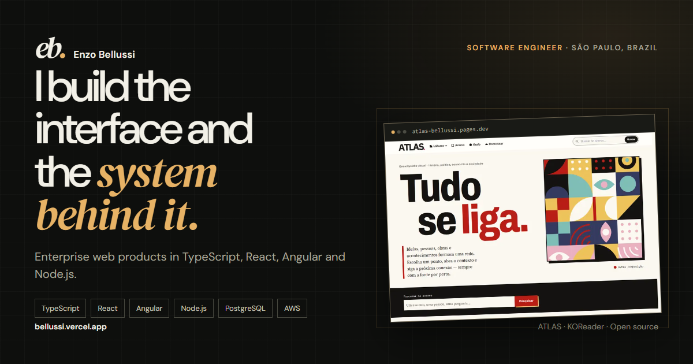

# Enzo Bellussi — Portfolio

Personal site of **Enzo Bellussi**, a software engineer based in São Paulo, Brazil. English-first, with a full Portuguese version, selected product case studies, experience, technical toolkit and downloadable resumes.

**Live:** [bellussi.vercel.app](https://bellussi.vercel.app) · **LinkedIn:** [in/enzo-bellussi](https://www.linkedin.com/in/enzo-bellussi/) · **GitHub:** [bellussi1](https://github.com/bellussi1)



## What is here

- **ATLAS case study** — the flagship open-source project: an interactive encyclopedia built on a sourced knowledge graph, with 896 entities, 7,918 sourced claims and 898 sources at the time of writing.
- **Selected products** — KOReader Ecosystem, Black Market and Comandinha, with real screenshots and current project status.
- **Open-source tools** — Deploy Preflight, Local Webhook Recorder and Compose Doctor.
- **Experience and toolkit** — enterprise work at MarketData and Banco do Brasil, plus the stack used across front end, back end, cloud and quality.
- **Bilingual experience** — English is the default; Portuguese is available through the language switch and `?lang=pt`.
- **Resume downloads** — ATS-oriented LaTeX resumes in English and Portuguese.

## Lighthouse

The production build is audited on mobile and desktop:

| Performance | Accessibility | Best practices | SEO |
| --- | --- | --- | --- |
| 100 | 100 | 100 | 100 |

Some deliberate choices behind those scores:

- No UI framework and no animation library. The site ships a small amount of vanilla JavaScript.
- Self-hosted, subsetted fonts with preload; no third-party font requests.
- AVIF/WebP images with responsive `srcset`, explicit dimensions and lazy loading below the fold.
- No scroll hijacking or heavy parallax. Motion is limited to short reveal transitions and respects `prefers-reduced-motion`.
- Semantic HTML, visible focus states, keyboard-friendly navigation, skip link and WCAG-minded contrast.
- English-first metadata, canonical URL, hreflang alternates, Open Graph, Twitter cards, JSON-LD and sitemap.

## Stack

- **HTML, CSS and modern JavaScript** — no framework.
- **Vite** for development and production builds.
- **Node.js 24** and the committed lockfile.
- **Vercel** for hosting.

## Development

```sh
npm ci
npm run dev
```

Validate and preview the production build:

```sh
npm test
npm run build
npm run preview
```

## Structure

```text
index.html                 English content, semantics, metadata and page structure
src/main.js                Language switch, navigation, reveal motion, contact copy
src/translations.js        Portuguese copy and UI strings
src/utils/page-metadata.js Language-aware title, description and social metadata
styles/style.css           Design tokens, layout, components, responsive rules and motion
public/fonts/              Self-hosted DM Sans and DM Serif Display subsets
public/images/             AVIF/WebP responsive product screenshots
cv/                        LaTeX sources and compiled ATS-oriented resumes
test/                      SEO, i18n, content and performance regression tests
```

## Updating content

1. Edit the English source in `index.html`.
2. Update the matching keys in `src/translations.js` for Portuguese.
3. Replace screenshots in `public/images/`, keeping the responsive sizes and alt keys.
4. Update the ATLAS numbers only when they match the published build. The current figures come from the project's content manifest.
5. Rebuild the resumes from `cv/curriculo-en.tex` and `cv/curriculo-pt.tex`, then copy the PDFs to `public/`.
6. Run `npm test` and `npm run build`.

## Content policy

Case studies describe work that exists. There are no invented metrics, client screenshots or confidential system details. Client code and internal systems belong to the respective companies. ATLAS numbers are derived from the published content bundle.

## Deployment

The project is connected to Vercel.

- Build command: `npm run build`
- Output directory: `dist`
- Node.js: 24.x

---

## Português

Portfólio profissional de **Enzo Bellussi**, engenheiro de software em São Paulo. O inglês é o idioma padrão, com versão completa em português, estudos de caso de produtos, experiência, ferramentas e currículos para download.

- **No ar:** [bellussi.vercel.app](https://bellussi.vercel.app)
- **Projeto principal:** [ATLAS](https://atlas-bellussi.pages.dev) — enciclopédia visual com grafo de conhecimento e fontes em cada afirmação.
- **Currículos:** `public/curriculo-en.pdf` e `public/curriculo-pt.pdf`; fontes em `cv/`.
- **Lighthouse:** 100 em performance, acessibilidade, boas práticas e SEO, no mobile e no desktop.

Para rodar localmente, use Node.js 24:

```sh
npm ci
npm run dev
```

Os textos em português ficam em `src/translations.js`; o HTML contém o inglês, que é o idioma padrão. As capturas de produto estão em `public/images/`. O README dos currículos, com instruções de compilação LaTeX, está em [`cv/README.md`](cv/README.md).
